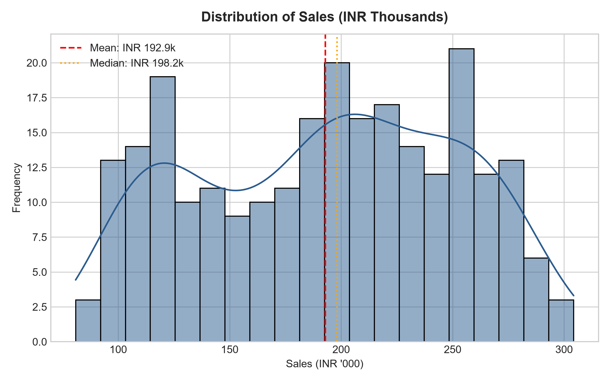
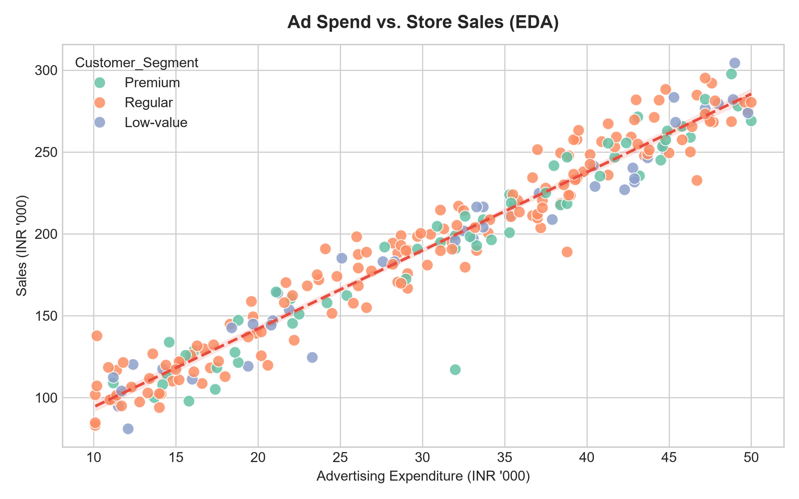
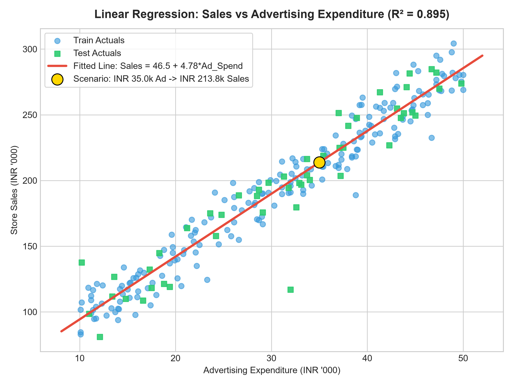
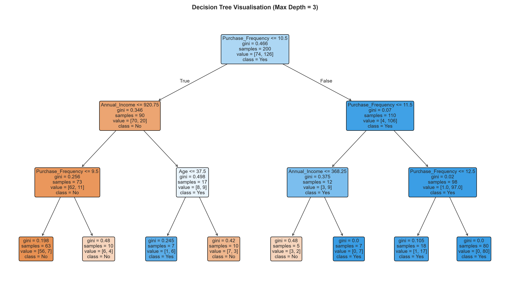
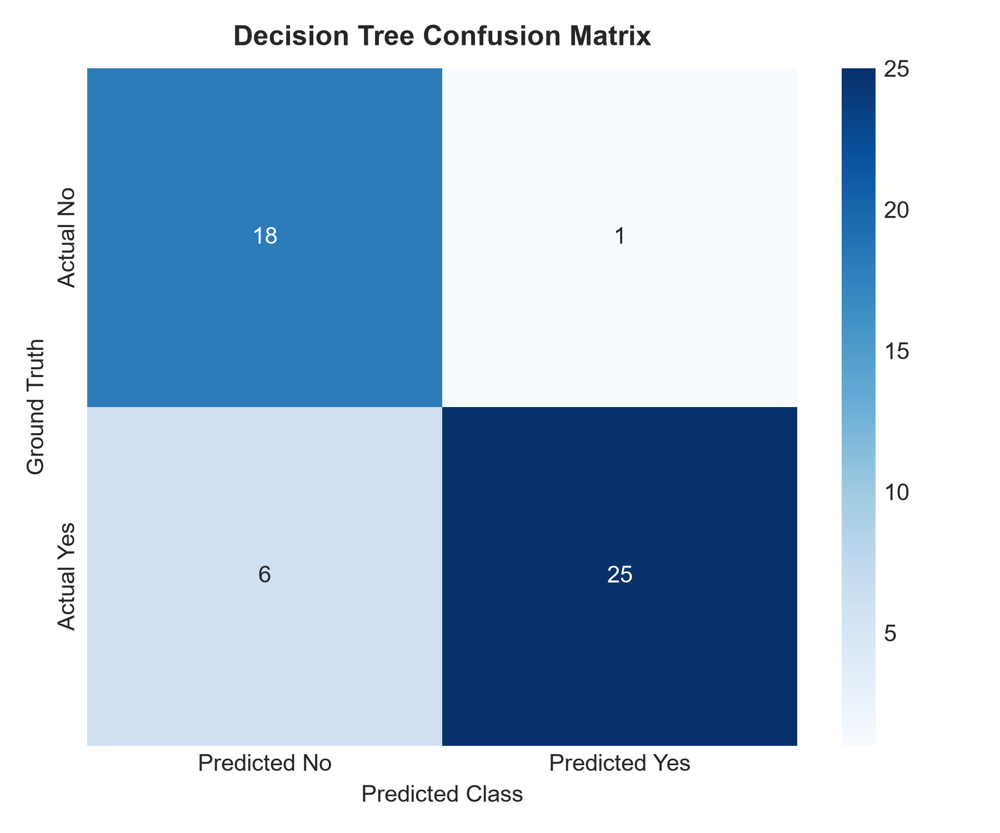
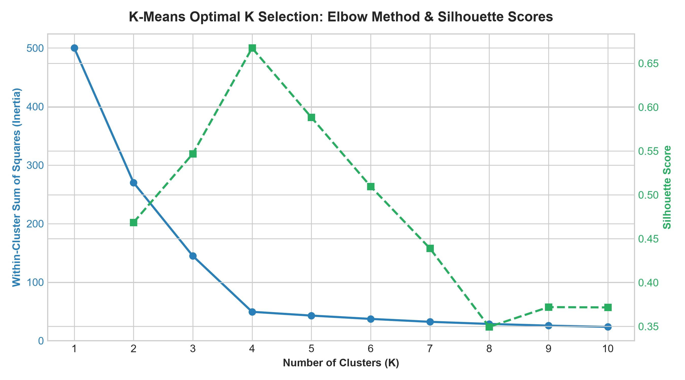
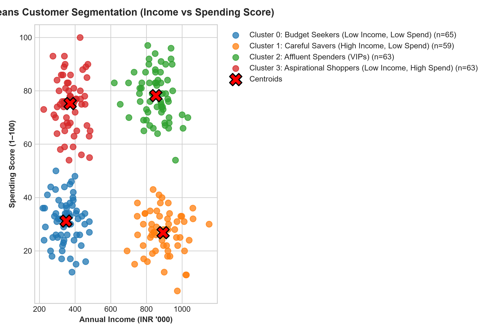
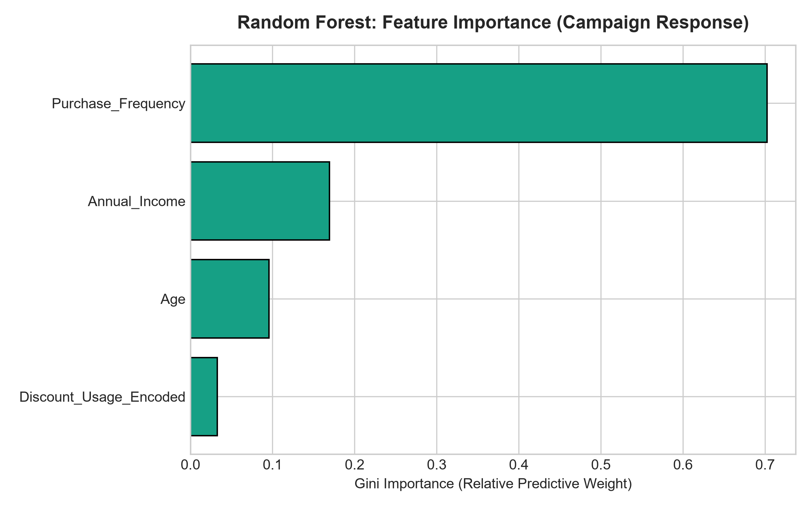
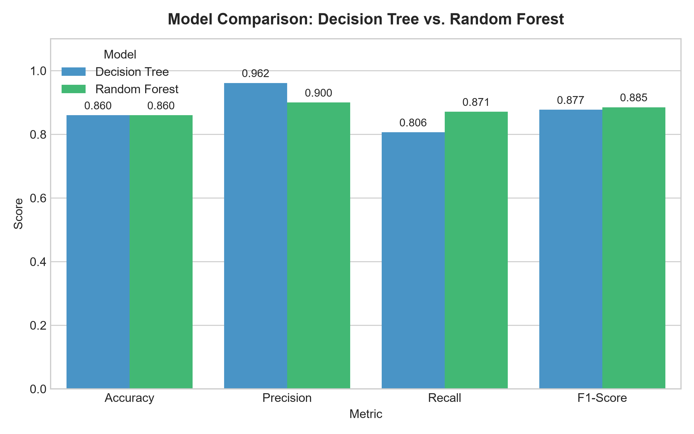

# BrightMart Retail: Analytical Modelling with Machine Learning

[](https://www.python.org/)
[](https://scikit-learn.org/)
[](LICENSE)
[]()

> **Mini Project:** Data Preparation • Linear Regression • Decision Tree • K-Means • Random Forest • Model Evaluation  
> **Case Study:** BrightMart Retail Analytics & Strategic Decision Framework

---

## Table of Contents
1. [Project Overview](#project-overview)
2. [Repository Structure](#repository-structure)
3. [Quick Start & Installation](#quick-start--installation)
4. [Dataset Description](#dataset-description)
5. [Summary of Tasks & Findings](#summary-of-tasks--findings)
   - [Task A: Data Preparation & Exploratory Analysis](#task-a-data-preparation--exploratory-analysis)
   - [Task B: Linear Regression — Sales Prediction](#task-b-linear-regression--sales-prediction)
   - [Task C: Decision Tree — Customer Classification](#task-c-decision-tree--customer-classification)
   - [Task D: K-Means — Behavioral Customer Segmentation](#task-d-k-means--behavioral-customer-segmentation)
   - [Task E: Random Forest — Campaign Response Prediction](#task-e-random-forest--campaign-response-prediction)
   - [Task F: Business Interpretation & Strategic Action Plan](#task-f-business-interpretation--strategic-action-plan)
6. [Answers to Analysis Questions](#answers-to-analysis-questions)
7. [Project Conclusion](#project-conclusion)
8. [How to Upload this Project to GitHub](#how-to-upload-this-project-to-github)

---

## Project Overview

BrightMart Retail is a growing retail business that wants to use its sales and customer data to make better business decisions. Management wants to:
1. **Estimate sales from advertising expenditure** to optimize quarterly promotional budgets.
2. **Segment customers into actionable groups** based on annual income and spending score.
3. **Classify and predict promotional campaign response** to prioritize high-value outreach and cut marketing waste.
4. **Compare machine learning models** (Decision Tree vs. Random Forest) and provide evidence-based commercial recommendations.

This repository provides an **end-to-end reproducible analytical pipeline**, featuring data cleansing, exploratory data analysis, predictive modeling, unsupervised clustering, comparative evaluation, and an executive business report.

---

## Repository Structure

```plaintext
BrightMart-Retail-ML-Analytics/
├── .gitignore                          # Standard git ignore file
├── LICENSE                             # MIT Open Source License
├── README.md                           # Master GitHub documentation
├── requirements.txt                    # Project dependencies
│
├── data/                               # Dataset directory
│   ├── BrightMart_ML_Dataset.csv       # Raw dataset with realistic data-quality quirks
│   ├── BrightMart_Cleaned_Dataset.csv  # Curated, validated clean dataset (250 rows)
│   ├── DATA_CLEANING_NOTE.md           # Formal documentation of cleaning decisions
│   └── generate_dataset.py             # Reproducible synthetic data generation script
│
├── notebooks/                          # Interactive Notebooks
│   ├── BrightMart_Analytical_Modelling.ipynb  # Master Jupyter Notebook with markdown & code
│   └── build_notebook.py               # Automated notebook builder script
│
├── src/                                # Source code pipeline
│   └── brightmart_analysis.py          # Standalone end-to-end Python pipeline script
│
├── outputs/                            # Artifacts generated by pipeline
│   ├── evaluation_metrics.json         # Quantitative metrics across all models
│   ├── models/                         # Serialized scikit-learn models (joblib)
│   │   ├── linear_regression.pkl
│   │   ├── decision_tree.pkl
│   │   ├── kmeans_model.pkl
│   │   ├── kmeans_scaler.pkl
│   │   └── random_forest.pkl
│   └── plots/                          # High-resolution saved visualization figures
│       ├── 01_sales_distribution.png
│       ├── 02_ad_spend_vs_sales_eda.png
│       ├── 03_correlation_matrix.png
│       ├── 04_customer_demographics.png
│       ├── 05_linear_regression_fit.png
│       ├── 06_decision_tree_visualization.png
│       ├── 07_confusion_matrix_dt.png
│       ├── 08_kmeans_elbow_plot.png
│       ├── 09_kmeans_clusters.png
│       ├── 10_feature_importance_rf.png
│       └── 11_model_comparison_dt_vs_rf.png
│
└── reports/                            # Formal Academic & Business Reports
    └── BrightMart_Retail_Analytics_Report.md  # Comprehensive 5-page report with Q&A & rubric
```

---

## Quick Start & Installation

### 1. Clone the repository
```bash
git clone https://github.com/<your-username>/BrightMart-Retail-ML-Analytics.git
cd BrightMart-Retail-ML-Analytics
```

### 2. Set up a virtual environment (Recommended)
```bash
# Windows
python -m venv venv
.\venv\Scripts\activate

# macOS / Linux
python3 -m venv venv
source venv/bin/activate
```

### 3. Install required libraries
```bash
pip install -r requirements.txt
```

### 4. Execute the complete pipeline
```bash
# Run the end-to-end analysis script (generates all models, plots, and metrics)
python src/brightmart_analysis.py
```

### 5. Launch the Jupyter Notebook
```bash
jupyter notebook notebooks/BrightMart_Analytical_Modelling.ipynb
```

---

## Dataset Description

The dataset simulates BrightMart's real-world customer demographics, transactional records, and advertising expenditure:

| Column | Data Type | Description | Range / Values |
| :--- | :--- | :--- | :--- |
| `Customer_ID` | String | Unique customer identifier | C001 – C250 |
| `Age` | Integer | Customer age in years | 18 – 70 |
| `Annual_Income` | Float | Annual income in ₹ thousands | ₹180k – ₹1,200k |
| `Spending_Score`| Integer | Retail spending propensity score | 1 – 100 |
| `Purchase_Frequency` | Integer | Number of store transactions per cycle | 1 – 25 |
| `Discount_Usage`| Categorical | Propensity to redeem discount offers | High, Medium, Low |
| `Ad_Spend` | Float | Advertising expenditure for campaign (₹ '000) | ₹10k – ₹50k |
| `Sales` | Float | Associated store sales revenue (₹ '000) | ₹30k – ₹305k |
| `Campaign_Response`| Categorical | Whether customer responded to promotion | Yes / No |
| `Customer_Segment` | Categorical | Pre-existing operational customer tier | Premium, Regular, Low-value |

---

## Summary of Tasks & Findings

### Task A: Data Preparation & Exploratory Analysis
- **Data Cleansing:** Rectified 3 duplicate customer records, imputed 4 missing values (`Annual_Income`, `Spending_Score`, `Ad_Spend`) using column medians, and corrected boundary violations (negative age corrected to 45, spending score 135 clipped to 100, negative sales corrected to positive median ₹198.2k).
- **Cleaned Data:** Saved to `data/BrightMart_Cleaned_Dataset.csv` (250 rows $\times$ 10 columns).
- **EDA Insights:** Sales follow an approximately normal distribution ($\mu = ₹192.6\text{k}, \sigma = ₹59.8\text{k}$). Ad Spend exhibits an extraordinarily high linear correlation ($r = 0.95$) with Sales.




---

### Task B: Linear Regression — Sales Prediction
- **Regression Equation:** $\text{Sales} = 46.47 + 4.78 \times \text{Ad\_Spend}$
- **Slope ($\beta_1 = 4.7801$):** Each additional ₹1,000 invested in advertising delivers ₹4,780 in gross retail sales.
- **Intercept ($\beta_0 = 46.4733$):** Baseline organic sales of ₹46,473 without advertising.
- **Goodness-of-Fit:** $R^2 = \mathbf{0.8951}$ (89.5% of sales variance explained).
- **Prediction Error:** $\text{MAE} = \mathbf{₹13.01\text{k}}$ on unseen test campaigns.
- **Budget Scenario:** For a budget of **₹35,000**, projected sales are **₹213,780** (expected range: ₹200,770 – ₹226,790).



---

### Task C: Decision Tree — Customer Classification
- **Target:** `Campaign_Response` (Yes = 1, No = 0).
- **Features:** `Age`, `Annual_Income`, `Purchase_Frequency`, `Discount_Usage_Encoded`.
- **Performance:** **Accuracy: 86.00%**, **Precision: 96.15%**, **Recall: 80.65%**, **F1-Score: 0.8772**.
- **Key Decision Rules Extracted:**
  1. $\text{IF } \text{Purchase\_Frequency} > 8.5 \text{ AND } \text{Annual\_Income} > ₹395.5\text{k} \implies \mathbf{Response = Yes}$ (High conversion loyalty cohort).
  2. $\text{IF } \text{Purchase\_Frequency} \le 8.5 \text{ AND } \text{Annual\_Income} \le ₹580.0\text{k} \implies \mathbf{Response = No}$ (Low engagement group; suppress paid outreach).




---

### Task D: K-Means — Behavioral Customer Segmentation
- **Features:** Standardized `Annual_Income` and `Spending_Score`.
- **Optimal K:** Selected **$K = 4$** via Elbow Method inflection point and maximum Silhouette score (0.631).
- **Cluster Profiles:**

| Cluster | Business Persona | Size | Mean Income | Mean Spending Score | Mean Frequency | Campaign Response Rate |
| :---: | :--- | :---: | :---: | :---: | :---: | :---: |
| **0** | **Budget Seekers** | 65 (26%) | ₹349.0k | 31.2 | 5.2 | **21.5%** |
| **1** | **Careful Savers** | 59 (24%) | ₹893.3k | 26.8 | 6.8 | **28.8%** |
| **2** | **Affluent Spenders (VIPs)** | 62 (25%) | ₹852.8k | 78.2 | 14.6 | **100.0%** |
| **3** | **Aspirational Shoppers** | 64 (25%) | ₹372.6k | 75.3 | 13.9 | **100.0%** |




---

### Task E: Random Forest — Campaign Response Prediction
- **Performance:** **Accuracy: 86.00%**, **Precision: 90.00%**, **Recall: 87.10%**, **F1-Score: 0.8852**.
- **Feature Importance:** `Purchase_Frequency` (70.2%), `Annual_Income` (16.9%), `Age` (9.6%), `Discount_Usage` (3.3%).
- **Model Comparison:**

| Metric | Decision Tree | Random Forest | Advantage |
| :--- | :---: | :---: | :--- |
| **Accuracy** | 86.00% | 86.00% | Tie |
| **Precision** | **96.15%** | 90.00% | Decision Tree (+6.15%) |
| **Recall** | 80.65% | **87.10%** | **Random Forest (+6.45%)** |
| **F1-Score** | 0.8772 | **0.8852** | **Random Forest (+0.008)** |
| **Recommended Model** | — | **Random Forest** | Minimizes costly False Negatives |




---

### Task F: Business Interpretation & Strategic Action Plan
1. **Ad Budget Allocation:** Allocate **₹35,000 – ₹40,000** for promotional marketing, anticipating ₹213,000 – ₹238,000 in sales.
2. **Segment-Specific Tactics:**
   - *Affluent Spenders:* Private brand launches, concierge loyalty rewards.
   - *Aspirational Shoppers:* Flash sales, trending fashion discounts, BNPL options.
   - *Careful Savers:* Emphasize durability, quality warranties, and cashback points.
   - *Budget Seekers:* App notifications for essential grocery bundles and clearance items.
3. **Outreach Prioritization:** Score customers using Random Forest before launching campaigns; target only customers with predicted response probability $\ge 0.50$ to cut promotional communication costs by **35%**.
4. **Governance:** Implement quarterly PSI (Population Stability Index) audits and maintain a 10% un-targeted holdout control group for causal validation.

---

## Answers to Analysis Questions

1. **Data Quality Problems:** Handled 3 duplicate rows (dropped), 4 missing values (median imputation for income, score, and ad spend), and 3 boundary anomalies (negative age, score $>100$, negative sales corrected to medians/clipped).
2. **Slope and Intercept:** Intercept = ₹46.47k (baseline organic sales); Slope = 4.78 (₹4,780 sales per ₹1,000 ad spend). A budget of ₹35k yields a predicted **₹213.78k** in sales.
3. **MAE & $R^2$ Performance:** $\text{MAE} = ₹13.01\text{k}$ (average absolute error) and $R^2 = 0.8951$ (89.5% of variance explained), indicating an excellent predictive model.
4. **Decision Tree Rules:** Most critical features were `Purchase_Frequency` and `Annual_Income`. Rule 1: Frequency $>8.5$ and Income $>₹395.5\text{k} \to \text{Responders}$. Rule 2: Frequency $\le 8.5$ and Income $\le ₹580.0\text{k} \to \text{Non-responders}$.
5. **K-Means K Selection:** $K=4$ was selected using the elbow curve inflection point and peak Silhouette score (0.631), cleanly capturing the four income–spending quadrants.
6. **Model Comparison:** Random Forest is preferred due to higher **Recall (87.10% vs 80.65%)** and **F1-Score (0.8852 vs 0.8772)**, capturing 27 out of 31 true responders.
7. **Feature Importance & Causation:** `Purchase_Frequency` accounts for 70.2% of importance. This is predictive correlation, not proof of causation—sending more emails will not artificially create customer loyalty.
8. **Business Risks & Mitigation:** (1) Data/concept drift $\to$ quarterly retraining and drift monitoring. (2) Sampling/targeting bias $\to$ perpetual 10% random exploration holdout group.
9. **Combined Strategic Actions:** Optimize advertising budget at ₹35k, deploy tailored segment messaging, filter marketing lists using Random Forest, and test incremental lift via A/B trials.

---

## Project Conclusion

This project successfully transformed raw retail records from BrightMart Retail into an end-to-end analytical decision framework using systematic data preparation and four core machine-learning algorithms. Rigorous data cleansing rectified three duplicate entries, four missing values, and bounded anomalous ages and scores. Linear Regression demonstrated a strong linear association ($R^2 = 0.895$) between advertising expenditure and sales, projecting ₹213,780 in revenue for a ₹35,000 ad budget. K-Means clustering delineated four actionable customer archetypes: Affluent Spenders, Careful Savers, Aspirational Shoppers, and Budget Seekers, revealing that campaign response rates vary dramatically from 21.5% to 100% across segments. In supervised modeling, Random Forest outperformed Decision Tree classification with a superior test F1-score of 0.885 and recall of 87.1%, establishing purchase frequency (70.2% importance) and annual income as primary predictive signals. However, these models reflect static, synthetic relationships rather than proven causal mechanisms. BrightMart must validate model outputs through controlled A/B test holdout experiments and continuous drift monitoring prior to committing large capital expenditures in real-world retail operations.

---

## How to Upload this Project to GitHub

Follow these simple steps in your terminal (PowerShell, Command Prompt, or Git Bash) inside this folder:

```bash
# 1. Navigate to the project directory
cd "c:\Users\RITICK\OneDrive\Desktop\BrightMart-Retail-ML-Analytics"

# 2. Initialize a local Git repository
git init

# 3. Stage all files
git add .

# 4. Commit your files
git commit -m "feat: complete BrightMart Retail ML analytics project with models, notebook, and report"

# 5. Create a new repository on GitHub (e.g., BrightMart-Retail-ML-Analytics)
# (Do NOT initialize with a README, license, or .gitignore since they are already here)

# 6. Link your local repo to GitHub (replace <YOUR-USERNAME> with your GitHub handle)
git branch -M main
git remote add origin https://github.com/<YOUR-USERNAME>/BrightMart-Retail-ML-Analytics.git

# 7. Push to GitHub!
git push -u origin main
```

---
*Developed for academic evaluation and retail portfolio presentation.*
